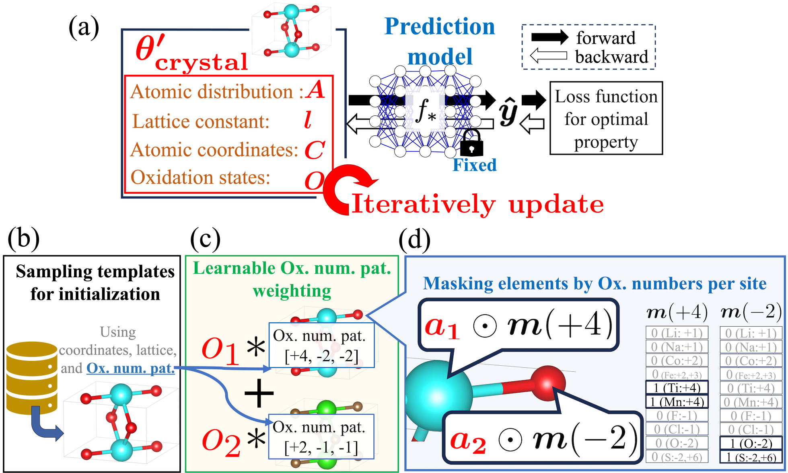
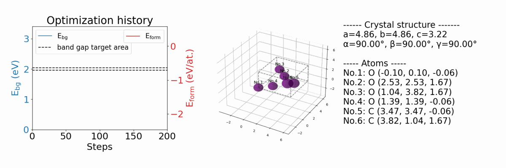

# Adaptable Method for Crystal Design across Diverse Constraints and Objectives with Pretrained Property Predictors

**Simultaneous Multi-property Optimization using Adaptive Crystal Synthesizer (SMOACS)** is a framework that utilizes state-of-the-art property prediction models and their gradients to directly optimize input crystal structures for multiple targeted properties simultaneously. It enables the integration of adaptive constraints into the optimization process without necessitating model retraining. This allows for optimizing targeted properties while maintaining specific crystal structures, such as perovskites, even with models trained on diverse crystal types.






## Paper
For detailed information, please refer to our paper:

[Adaptable Method for Crystal Design across Diverse Constraints and Objectives with Pretrained Property Predictors](https://arxiv.org/abs/2410.08562)

### Citation

If you use this work in your research, please cite:

```text
@article{afujii2024,
  title={Adaptable Method for Crystal Design across Diverse Constraints and Objectives with Pretrained Property Predictors},
  author={Akihiro FUJII, Yoshitaka Ushiku, Koji Shimizu, Anh Khoa Augustin Lu, Satoshi Watanabe },
  journal={arXiv preprint arXiv:2410.08562},
  year={2024}
}
```

The code in this repository uses code derived from Crystalformer and a minimal
vendored runtime subset from ALIGNN. Crystalformer's pretrained models are
provided in [CrystalFormer's official repository](https://github.com/deepmodeling/CrystalFormer),
and ALIGNN's pretrained models are provided in
[ALIGNN's official repository](https://github.com/usnistgov/alignn). Thus, if
you use our code in your projects, please cite both our work and the
Crystalformer paper or ALIGNN:

### Crystalformer
```text
@inproceedings{taniai2024crystalformer,
  title     = {Crystalformer: Infinitely Connected Attention for Periodic Structure Encoding},
  author    = {Tatsunori Taniai and
               Ryo Igarashi and
               Yuta Suzuki and
               Naoya Chiba and
               Kotaro Saito and
               Yoshitaka Ushiku and
               Kanta Ono
               },
  booktitle = {The Twelfth International Conference on Learning Representations},
  year      = {2024},
  url       = {https://openreview.net/forum?id=fxQiecl9HB}
}
```

### ALIGNN
```text
@article{choudhary2021atomistic,
  title={Atomistic line graph neural network for improved materials property predictions},
  author={Choudhary, Kamal and DeCost, Brian},
  journal={npj Computational Materials},
  volume={7},
  number={1},
  pages={185},
  year={2021},
  publisher={Nature Publishing Group UK London}
}
```

### MatterSim
```text
@article{yang2024mattersim,
      title={MatterSim: A Deep Learning Atomistic Model Across Elements, Temperatures and Pressures},
      author={Han Yang and Chenxi Hu and Yichi Zhou and Xixian Liu and Yu Shi and Jielan Li and Guanzhi Li and Zekun Chen and Shuizhou Chen and Claudio Zeni and Matthew Horton and Robert Pinsler and Andrew Fowler and Daniel Zügner and Tian Xie and Jake Smith and Lixin Sun and Qian Wang and Lingyu Kong and Chang Liu and Hongxia Hao and Ziheng Lu},
      year={2024},
      eprint={2405.04967},
      archivePrefix={arXiv},
      primaryClass={cond-mat.mtrl-sci},
      url={https://arxiv.org/abs/2405.04967},
      journal={arXiv preprint arXiv:2405.04967}
}
```


### Third-party code and licenses

This repository includes a minimal ALIGNN runtime subset under
`third_party/alignn_minimal/`, vendored from ALIGNN.
This is done so SMOACS can be tested in modern environments, including
NumPy 2.x environments, without being blocked by the external `alignn` package
dependency metadata. The external `alignn` Python package is not required at
runtime for SMOACS. See `third_party/alignn_minimal/LICENSE.rst` and
`THIRD_PARTY_NOTICES.md` for license, provenance, vendored-file scope, and local
change details. SMOACS original code is MIT licensed; third-party files are
governed by their respective licenses or terms. Pretrained weights are not
vendored.


## Requirements

SMOACS currently documents two environment profiles.

- **Paper environment**: use this for paper reproduction.
- **Modern environment**: use this for newer Python and NumPy 2.x execution.

Full reproduction CLI validation of this revision in both profiles is pending.
The Paper atomate2 pin below has been used in the research environment, but has
not yet been validated with the complete pinned Paper stack.

The external `alignn` Python package is not required in either profile. SMOACS
uses the vendored minimal ALIGNN runtime subset under
`third_party/alignn_minimal/`.

`pyproject.toml` is the modern install metadata. The legacy dependency snapshot
is kept in `pyproject.legacy.toml` for reference only; `pip` and Poetry do not
consume it automatically. For the paper environment, install the pinned
dependencies below explicitly and then install this repository with `--no-deps`.

CUDA-specific PyTorch, DGL, and PyG packages are installed outside Poetry.
Use wheels that match your CUDA runtime. The commands below target CUDA 12.4.

### Paper environment

Dependency profile (validate this checkout with the smoke commands below):

- Python 3.10.14
- NumPy 1.26.4
- PyTorch 2.4.0+cu124
- DGL 2.4.0+cu124
- PyTorch Geometric 2.7.0
- pymatgen 2025.6.14
- ASE 3.27.0
- atomate2 0.0.22 for MatterSim hull workflows
- setuptools 80.10.2
- MatterSim 0.1.dev5, only for MatterSim energy and hull workflows

Create a Python 3.10 virtual environment:

```bash
python3.10 -m venv venv
source venv/bin/activate
python -m pip install --upgrade pip "setuptools<81" wheel
```

Install PyTorch, DGL, and PyG for CUDA 12.4:

```bash
python -m pip install \
  torch==2.4.0 torchvision==0.19.0 torchaudio==2.4.0 \
  --index-url https://download.pytorch.org/whl/cu124

python -m pip install \
  "dgl==2.4.0+cu124" \
  -f https://data.dgl.ai/wheels/torch-2.4/cu124/repo.html

python -m pip install \
  torch-geometric pyg_lib torch_scatter torch_sparse torch_cluster torch_spline_conv \
  -f https://data.pyg.org/whl/torch-2.4.0+cu124.html
```

Install SMOACS runtime dependencies:

```bash
python -m pip install \
  "numpy==1.26.4" \
  "pymatgen==2025.6.14" \
  scipy \
  pandas \
  matplotlib \
  tqdm \
  requests \
  "ase==3.27.0" \
  jarvis-tools \
  periodictable \
  "smact==2.5.5" \
  "ipython==8.10.0" \
  pytest \
  optimade \
  optuna \
  pydantic \
  pydantic-settings \
  scikit-learn \
  lmdb \
  pyyaml \
  mp-api \
  "atomate2==0.0.22"
```

Install this repository without letting the modern `pyproject.toml` alter the
paper environment dependencies:

```bash
python -m pip install -e . --no-deps
```

Because this install deliberately keeps the paper dependency stack while
`pyproject.toml` describes the modern stack, `pip check` reports expected
metadata conflicts in this profile. Validate the installed imports and the
[small runs below](#minimal-command-check) before launching full experiments.

### Modern environment

Dependency profile (validate this checkout with the smoke commands below):

- Python 3.12.13
- NumPy 2.4.3
- PyTorch 2.4.0+cu124
- DGL 2.4.0+cu124
- PyTorch Geometric 2.7.0
- pymatgen 2026.5.4
- scipy 1.17.1
- pandas 3.0.2
- ASE 3.27.0
- atomate2 0.1.4 for MatterSim hull workflows
- setuptools 80.10.2
- external `alignn` package: not installed
- differentiable MatterSim: installed from
  <https://github.com/AkiraTOSEI/differentiable-mattersim>

Create a conda environment:

```bash
conda create -n smoacs-modern -y python=3.12.13 pip
conda activate smoacs-modern
python -m pip install -U pip "setuptools<81" wheel
```

Install PyTorch, DGL, and PyG for CUDA 12.4:

```bash
python -m pip install \
  torch==2.4.0 torchvision==0.19.0 torchaudio==2.4.0 \
  --index-url https://download.pytorch.org/whl/cu124

python -m pip install \
  "dgl==2.4.0+cu124" \
  -f https://data.dgl.ai/wheels/torch-2.4/cu124/repo.html

python -m pip install \
  torch-geometric pyg_lib torch_scatter torch_sparse torch_cluster torch_spline_conv \
  -f https://data.pyg.org/whl/torch-2.4.0+cu124.html
```

Install SMOACS and the pure-Python runtime dependencies. In the modern profile,
the normal install also installs the differentiable MatterSim fork declared in
`pyproject.toml`. It does not download MatterSim checkpoints.

```bash
python -m pip install -e .[dev]
python -m pip install "atomate2==0.1.4"
```

Check the installed environment from the repository root (either profile):

```bash
PYTHONPATH=. python - <<'PY'
import importlib.metadata as md
import sys

import dgl
import torch
from third_party.alignn_minimal.models.alignn import ALIGNNConfig

print("python:", sys.version.split()[0])
for pkg in ["numpy", "torch", "dgl", "torch-geometric", "pymatgen", "mattersim", "atomate2", "alignn"]:
    try:
        print(f"{pkg}:", md.version(pkg))
    except md.PackageNotFoundError:
        print(f"{pkg}: NOT INSTALLED")
print("torch CUDA runtime:", torch.version.cuda)
print("CUDA available:", torch.cuda.is_available())
print("vendored ALIGNN config:", ALIGNNConfig.__name__)
if torch.cuda.is_available():
    g = dgl.graph(([0, 1], [1, 2])).to("cuda")
    print("DGL graph device:", g.device)
PY
```

For MatterSim energy loss, install the differentiable MatterSim implementation.
The standard PyPI `mattersim` package does not provide
`mattersim.forcefield.differentiable_potential`, which SMOACS uses for
backpropagation through the energy term. The differentiable implementation is a
fork of the MatterSim repository with differentiable energy evaluation added:
<https://github.com/AkiraTOSEI/differentiable-mattersim>.

In the modern environment, `python -m pip install -e .[dev]` installs this fork.
The checkout below pins the research-compatible revision for either profile.
In the paper environment, install the runtime pieces needed by MatterSim energy
evaluation explicitly, then install the fork without dependencies so the pinned
NumPy is not upgraded. The research runtime uses fork revision
`71d640e21c4d3293ae4a968bc64c12e118f42a92`, whose differentiable API supports
`create_graph_forces` and `create_graph_stress`. Use this revision in either
profile; an older fork can fail even for energy-only runs. Keep ASE at 3.27.0; ASE 3.28.0 removed the
`full_3x3_to_voigt_6_stress` import path used by this fork.

```bash
git clone https://github.com/AkiraTOSEI/differentiable-mattersim differentiable_mattersim
git -C differentiable_mattersim checkout 71d640e21c4d3293ae4a968bc64c12e118f42a92
python -m pip install \
  deprecated \
  "e3nn>=0.5.0" \
  loguru \
  opt_einsum_fx \
  seekpath \
  phonopy \
  "torch-ema>=0.3" \
  "torch_runstats>=0.2.0" \
  "torchmetrics>=0.10.0"
python -m pip install -e ./differentiable_mattersim --no-deps
```

Download the 5M checkpoint and export the path before running half-metal
searches or MatterSim autograd checks:

```bash
python -c "from mattersim.utils.download_utils import download_checkpoint; download_checkpoint('mattersim-v1.0.0-5M.pth')"

export SMOACS_MATTERSIM_MODEL="$HOME/.local/mattersim/pretrained_models/mattersim-v1.0.0-5M.pth"
```

The published MatterSim workflow uses the 5M checkpoint at this standard path,
including post-processing. Keep `SMOACS_MATTERSIM_MODEL` set to that file.
The SMOACS weight downloader does not download MatterSim checkpoints.
For optimization with force or pressure losses, also pass this path explicitly
through the existing `--mattersim_model` option.

### Pretrained model weights
Model weights are not committed to this repository. Download the ALIGNN weights
used by Sections 2.2–2.4 with:

```bash
python scripts/download_model_weights.py \
  --only mp_gappbe_alignnn mp_e_form_alignnn jv_magmom_alignn
```

The full manifest is kept in `manifests/model_weights_manifest.tsv` for optional
tasks. Download only the weights needed by the command you are running.

The default paths are:

- ALIGNN weights: `models/alignn_pretrained/*.zip`
- MatterSim checkpoint: download with differentiable MatterSim's
  `download_checkpoint` helper to the standard 5M path above

CrystalFormer weights are not downloaded by `scripts/download_model_weights.py`.
If you run the CrystalFormer examples, download the required files from the
[CrystalFormer GitHub page](https://github.com/deepmodeling/CrystalFormer) and
place these three files under `models/crystalformer/`:

- `default.json`
- `megnet-bandgap-layer4.ckpt`
- `megnet-e_form-layer4.ckpt`

All three are required for Sections 2.1 and 2.2. The configuration and checkpoint
files must come from the same Crystalformer model release.

### Auxiliary data

The small auxiliary files used by optimization and oxidation-state masks are
included in this repository:

- `data/intermidiate/mask_dict_super_common.npz`
- `data/intermidiate/ionic_mask_dict_super_common.npz`
- `data/intermidiate/ionic_radii_dict_super_common.npz`

Generated initial structures, run outputs, model weights, and MatterSim
reference caches are intentionally not committed.


## Structure optimization and reproducibility

The scripts and data for Results Sections 2.1–2.4 of the paper are provided in
[reproducibility/](reproducibility/README.md).

Because the reproducibility package includes large initial-structure and mask files,
it is distributed as a separate archive. Download
[reproducibility.tar.gz](https://drive.google.com/file/d/1AkoDieWZFWFm8UgBXrS61XvfiHjtiEGC/view?usp=sharing)
to the repository root, then run the following command from that directory:

```bash
tar -xzf reproducibility.tar.gz \
  reproducibility/section_2_1/templates_masks \
  reproducibility/section_2_2/templates_masks \
  reproducibility/section_2_3/templates_masks \
  reproducibility/section_2_4/templates_masks \
  reproducibility/section_2_4/half-metal_candidate_dft_inputs
```

This extracts the fixed inputs into the existing `reproducibility/` directory.
Run the scripts from this Git checkout: an older download may contain older
scripts, so the extraction command selects only the data directories. After preparing the environment and
models described above, you can run the section-specific commands below.

Initial structures and masks are stored in each section's `templates_masks/` directory.

The experiment settings, inputs, and output locations are listed in [experiment_manifest.md](reproducibility/experiment_manifest.md).

| Section | Experiment settings | Run script |
| --- | --- | --- |
| 2.1 | Crystalformer; template geometry / oxidation-state mask ablation × Adam / Adam + SA / Adam + mutation / Adam + SA + mutation; 256 candidates per condition | [run_section_2_1.sh](reproducibility/section_2_1/run_section_2_1.sh) |
| 2.2 | ALIGNN/Crystalformer × unit cell/3×3×3 supercell × band gap 0.5/4.0 eV; 128 candidates per condition | [run_section_2_2.sh](reproducibility/section_2_2/run_section_2_2.sh) |
| 2.3 | Band gap 2.5/3.0/3.5/4.0/4.5 eV; 512 candidates per condition | [run_section_2_3.sh](reproducibility/section_2_3/run_section_2_3.sh) |
| 2.4 | trial00010, level5, element-count loss weight 100/1000 × integer magnetic-moment loss weight 1/10/100; 8,192 candidates per condition, batch size 150 | [run_section_2_4.sh](reproducibility/section_2_4/run_section_2_4.sh) |

The four scripts run 35 conditions in total: 16 + 8 + 5 + 6.
The runtime follows the research implementation with corrections for loading,
geometry, and final partial batches. New results need not match saved paper
numbers exactly. Section 2.2 uses author-selected inputs and the current presets;
its complete historical settings have not been reconciled. Section 2.4 uses the
author-selected current input PKL, which differs from the saved third-run input.

Each script specifies the input paths, optimizer, number of iterations, learning rates, loss coefficients, candidate count, batch size,
and `--seed 42`. The scripts change to the repository root internally,
so they can be launched from their respective section directories. Each example below starts at the repository root.

### Minimal command check

After installing the models and extracting the inputs, run the same four scripts
with `SMOACS_SMOKE_TEST=1` from the repository root:

```bash
set -e
for section in 2_1 2_2 2_3 2_4; do
  SMOACS_DEVICE=cpu SMOACS_SMOKE_TEST=1 bash "reproducibility/section_${section}/run_section_${section}.sh"
done
```

`SMOACS_DEVICE=cpu` runs optimization on the CPU. The default is `cuda`;
Crystalformer uses its existing PyTorch implementation on the CPU.
Its fixed lattice range differs from the CUDA implementation's adaptive cutoff,
so CPU smoke runs check execution and gradients, not numerical agreement with
CUDA or the paper results.

This runs all 35 conditions with two candidates, batch size two, and ten steps,
and appends `__smoke` to each experiment name. Mutation steps are 5/7 in Section
2.1, 2/5/7 in Sections 2.2–2.4 (5/7 for Crystalformer unit cells), and the hybrid
optimizer uses five gradient steps in Sections 2.3/2.4. Seeds, input files, models,
and loss coefficients stay the same. Without this environment variable, each
script uses the full settings listed above. These small runs check execution;
they are not intended to reproduce the paper's success rates.

A complete direct CLI example with MatterSim energy loss is shown below. Run it
from the repository root after completing model and data preparation:

```bash
python main.py \
  --model_name ALIGNN --task bg_and_eform \
  --target_val 2.5 --training_margin 0.04 --eval_margin 2.0 \
  --e_form_coef 1.0 --e_form_criteria 1.0 \
  --space_group -1 --optimizer gradient \
  --num_candidate 2 --b_size 2 --num_steps 10 --num_workers 0 \
  --initial_structures_path reproducibility/section_2_3/templates_masks/initial_mp_nsites2_12__mask_dict_super_common.pkl \
  --mask_dict_path reproducibility/section_2_3/templates_masks/masks/mask_dict_super_common.npz \
  --alignn_weights_dir models/alignn_pretrained \
  --energy_coef 1.0 --energy_every 1 \
  --mattersim_model "$SMOACS_MATTERSIM_MODEL" \
  --exp_name readme_energy__smoke --device cpu --seed 42
```

For post-processing a smoke run, pass its suffixed experiment name and use the
same environment variable to set MatterSim's relaxation limit to ten steps:

```bash
python reproducibility/prepare_mattersim_inputs.py \
  section_2_3 section_2_3_bg2p5__smoke
SMOACS_SMOKE_TEST=1 bash reproducibility/run_mattersim.sh \
  section_2_3 section_2_3_bg2p5__smoke
```

Set `MP_API_KEY` before the last command. A ten-step relaxation may be
unconverged; inspect its status before interpreting hull energies. Section 2.4
may select no candidates at this scale; the wrapper requires nonempty inputs.
Use a fresh experiment name/output directory for repeated runs.

### Crystalformer ablation study

Section 2.1 compares four combinations of template geometry and oxidation-state masks
with four update methods. All 16 conditions use 256 candidates, batch size 256,
200 steps, seed 42, and a target band gap of 2.5 ± 0.04 eV.
The fixed templates, their read order, and precomputed masks are included in
`reproducibility/section_2_1/templates_masks/`.

```bash
cd reproducibility/section_2_1
bash run_section_2_1.sh
```

See the [reproducibility README](reproducibility/README.md) for the ablation definitions,
initialization controls, and output names.

### Multi-property design of perovskite structures

The same script runs the unit-cell and 135-atom 3×3×3 supercell experiments in Section 2.2.
For each cell size, the inputs contain the first 128 structures in the original directory's read order, as specified by the authors for this release.
The selected filenames and their read order are preserved.

```bash
cd reproducibility/section_2_2
bash run_section_2_2.sh
```

### Bandgap Optimization

Section 2.3 uses the first 512 entries in the saved PKL file and the saved arguments for the five conditions.
There is no need to generate new initial structures from Materials Project.

```bash
cd reproducibility/section_2_3
bash run_section_2_3.sh
```

### Half metal proposal

Section 2.4 uses
`initial_mp_nsites2_30__mask_dict_super_common_level5.pkl`, as specified by the authors for this release.
The file contains all 10,050 entries; the first 8,192 are used for this rerun.
Details of the inputs and execution procedure are provided in the [reproducibility README](reproducibility/README.md).

```bash
cd reproducibility/section_2_4
bash run_section_2_4.sh
```

Run outputs are saved in `results/<exp_name>/` under the repository root.

## Output files

| File path | Contents |
| --- | --- |
| `results/<exp_name>/result_summary.csv` | Run-level summary of evaluation metrics, success rates, and related statistics |
| `results/<exp_name>/result.csv` | Per-candidate evaluation results associated with the initial-structure IDs |
| `results/<exp_name>/result.npz` | Arrays containing optimization results |
| `results/<exp_name>/poscar/*.vasp` | Structures immediately after SMOACS optimization; POSCAR is the default output format |
| `results/<exp_name>/history_img.png` | Plot of the optimization history |
| `results/<exp_name>/opt_timing.jsonl` | Records of data counts, processing times, and related information (Sections 2.2–2.4) |
| `results/<exp_name>/run_config.json` | Effective settings for the Section 2.1 ablation run |

### Details for `result_summary.csv`


This file provides a summary of the optimization performance across all generated structures, including metrics such as success rates, uniqueness, and novelty.

| Column | Description |
|--------|-------------|
| `success` | Ratio of structures that satisfy all evaluation criteria (see `success` in the main result file). |
| `*_success` | Ratio of structures that satisfy the criteria of each peoperty or constraint. |
| `tolerance_success` | Ratio of structures that satisfy the tolerance factor constraint. |
| `perov_success` | Ratio of perovskite structures that pass the geometry and coordinate checks. |
| `Tc_above_5.0`, `Tc_above_10.0`, ... | Ratio of structures whose predicted Tc exceeds the specified threshold (used in maximization mode). |
| `is_neutral_cmn` | Ratio of structures that are electrically neutral. |
| `minbond_less_than_0.5` | Ratio of structures with all bond lengths ≥ 0.5Å. |
| `success_nuique_rate` | Fraction of successful structures that are also structurally unique. |
| `newly_megnet_success` | Number of successful structures that are novel (not present in the reference MEGNet dataset). |

This summary helps users understand the effectiveness of the optimization process and the quality of generated candidates at a glance.


### Details for `result.csv`
A file for evaluation result for each optimized structures including successeeded and failed ones.
| column | description |
| ---- | ---- |
| `original_fnames`| file names of initial structures in the directory of `dir_path` |
| `batch_abc` | values of lengths of crystal vectors $a,b,c$ |
| `batch_angle`| values of angles of crystal vector $\alpha,\beta,\gamma$|
| `*_onehot` | optimized values with one-hot atomic distributions. e.g., `bandgap_onehot`|
| `loss_*_onehot` |loss values after optimization with one-hot atomic distributions. e.g., `loss_bandgap_onehot`|
| `*_success` | whether to meet its criterion|
| `Tc_above_5.0`, `Tc_above_10.0`, ... |  whether predicted Tc exceeds the specified threshold (used in maximization mode). |
| `is_neutral_cmn`  | electrical neutrality|
| `minbond_less_than_0.5` | whether the all bonds are longer than 0.5Å |
| `ox_states`  | oxidation numbers (available only if the structure is electrically neutral). The order is the same as `elements`.|
| `perov_success`  | whether to  meet both (85°<$\alpha,\beta,\gamma$< 95°) and `perov_coords`|
| `tolerance_success`  | whether tolerance value $t$ meets its criterion|
| `perov_coords`  | whether the displacements of fractional coordinates are within $\epsilon$ (0.15) |
| `success`  | overall success. If the following conditions are met at the same time: `*_success` and `valid_structure` for non-perovskite optimization; `*_success`, `valid_structure` and `perov_success` for perovskite optimization|

## MatterSim convex-hull evaluation from SMOACS POSCAR outputs

`scripts/calculate_mattersim_convex_hull_energy.py` relaxes the POSCAR structures proposed by
SMOACS using MatterSim and calculates their convex-hull energies relative to reference phases
obtained from Materials Project (MP) and Alexandria. It also records the uniqueness of the relaxed
structures and their novelty relative to the reference phases. This script does not perform
DFT calculations or DOS-based half-metal identification.

For Sections 2.3 and 2.4, first copy the structures from `results/<exp_name>/poscar/` into
the experiment-specific `to_relax_poscars/` directory, then run the four MP + Alexandria stages.
Below, `<S>` denotes `section_2_3` or `section_2_4`, `<E>` is the experiment name used for SMOACS
`--exp_name`, and `<M>` denotes `reproducibility/<S>/mattersim`.

| Input/output | File or directory | Contents and corresponding argument |
| --- | --- | --- |
| Source | `results/<E>/result.csv`, `results/<E>/poscar/*.vasp` | SMOACS optimization results and proposed structures |
| Input | `<M>/to_relax_poscars/<E>/*.vasp` | Proposed structures copied without modification for MatterSim evaluation. `-p_dir` |
| Input preparation record | `reproducibility/<S>/screening_logs/<E>_mattersim_inputs.csv` | Selection results for all SMOACS rows, original IDs, MatterSim IDs, destination paths, and SHA-256 hashes |
| Output | `<M>/relaxed_poscars/<E>/*_relaxed.vasp` | Proposed structures relaxed using MatterSim. `-r_dir` |
| Output | `<M>/results/<E>/relax_results.csv` | `fname`, `e_hull_mp`, `e_hull_mp_alex`, `structural_novelty`, `unique_structure`, and related fields. `-rr_dir` |
| Output | `<M>/DFT_POSCARS/<E>/<proposal_id>/` | POSCAR files for proposed structures and reference phases selected by stability, together with `material_summary.csv`. `-s_dir`. These are not complete DFT input sets or DFT calculation results |
| Record | `<M>/cache/<E>/screening_results.jsonl` | First-stage hull evaluation using MP references. `--cache_dir` |
| Record | `<M>/cache/<E>/proposal_relax_records.jsonl` | Relaxation records for proposed structures, including failure statuses |
| Reference retrieval records | `mp_requests_cache.sqlite`, `alex_requests_cache.sqlite`, `*_fetch_done.json`, and `chemsys_to_fetch.json` under `<M>/cache/<E>/` | Retrieved reference phases, chemical systems already retrieved, and targets for Alexandria retrieval |
| Reference relaxation data | `<M>/reference/<E>/` | Relaxed reference structures, `relax_results.json`, chemical-system-specific `relax_results_*.json.gz`, and `DFT_POSCARS/` for reference selection. `--global_relax_dir` |
| Run records | `<M>/results/<E>/run_environment.json`, `prefetch_MP.log`, `MatterSim_phase1.log`, `prefetch_Alex.log`, `MatterSim_phase2.log` | Identifying information for the environment, models, and scripts used, plus standard output and standard error from each stage |
| Progress and elapsed time | `<M>/results/<E>/logs/time_logs/`, `<M>/results/<E>/timing_logs/` | Records written by the underlying script to its working directory |


After running SMOACS, run the following two commands from the repository root to prepare the inputs and evaluate them.
Set your Materials Project API key in the `MP_API_KEY` environment variable.
The `atomate2` package is also required to create the VASP settings for new relaxations.

```bash
python reproducibility/prepare_mattersim_inputs.py \
  section_2_3 section_2_3_bg2p5
bash reproducibility/run_mattersim.sh \
  section_2_3 section_2_3_bg2p5
```

For Section 2.4, set the first argument to `section_2_4` and the second to the target experiment name.
During input preparation, all proposals are selected for Section 2.3. For Section 2.4, structures are selected if their band gap is at most 0.05 eV,
they contain at most five elements, and their saved distance-check flag is True. Original IDs and selection reasons are recorded in a CSV file.
`run_mattersim.sh` runs the stages in the order
`prefetch_MP → MatterSim_phase1 → prefetch_Alex → MatterSim_phase2`. For the models, settings for each stage, and interpretation of the results,
see [reproducibility/README.md](reproducibility/README.md).
